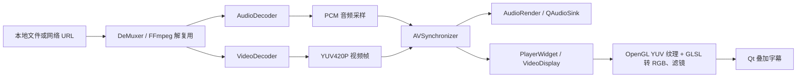
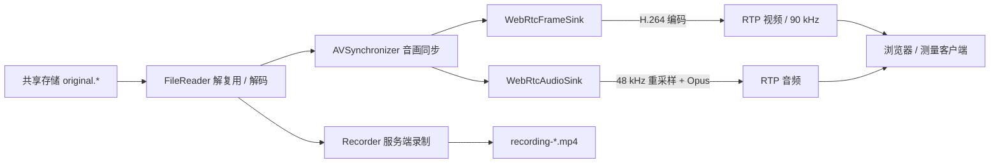
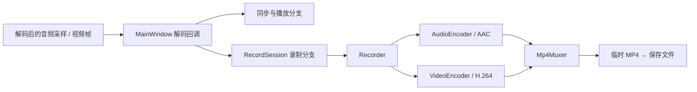
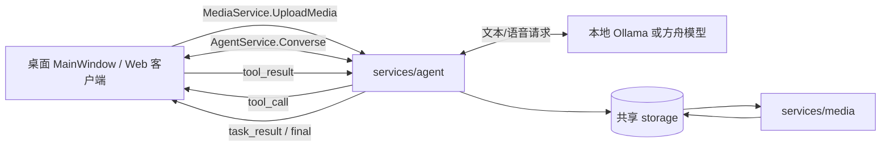

# 📋 项目简介

AVPlayer 是一套 **C++17 + Qt + FFmpeg + OpenGL** 的音视频播放与流媒体系统，由两个客户端和两个服务端单元组成：

- **`services/media`（C++）**：复用共享媒体核心做解复用/解码/音画同步/编码，把 H.264 + Opus 经 WebRTC 实时推给浏览器，并支持服务端录制与播放控制；
- **`services/agent`（Python）**：媒体上传、字幕转写、摘要/语义搜索/智能剪辑、LangGraph 工具编排，可选 Redis 字幕缓存与 MySQL 元数据；
- **`apps/desktop`（Qt）**：本地/网络媒体播放、滤镜与贴纸、录制、截图，以及 AI/Agent 侧栏；
- **`apps/web`（Vite + TS）**：浏览器端播放，控制与 AI 经 Web 网关访问同一套 gRPC 服务。

桌面端与服务端通过 `avplayer.agent.v1` gRPC 契约通信，媒体面（WebRTC）与控制面（gRPC/HTTP）分离——音视频不经过网关。各部署单元职责见下文“项目结构与数据流”。


# ✨ 核心功能

## 基础播放

-   基于 FFmpeg 解复用与解码常见音视频格式；实际可播放格式取决于所链接的 FFmpeg 构建
-   支持本地文件以及由 FFmpeg 打开的 HTTP(S)、RTSP、RTMP 等网络媒体源
-   播放控制：播放 / 暂停、进度拖拽和跳转到开头

## 高级功能

-   🎥 **音视频录制**：对当前媒体的解码帧重新编码，封装为 MP4
-   🎨 **视频滤镜**：灰度、反相、垂直翻转及动态贴纸
-   🧠 **人脸关键点**：OpenCV LBF 输出 68 点后做有效性校验（坐标有限、落在人脸框内、双眼间距达标），不达标时回退人脸框估算贴纸位置，避免贴纸漂移到原点
-   📸 **画面截图**：保存播放器当前显示画面
-   🌐 **WebRTC 拉流**：服务端解码/编码，H.264 + Opus 回传，Qt 与 Web 两端可播放
-   🧩 **Web 客户端同构**：播放、进度/seek、服务端录制、截图下载、灰度/反相/翻转滤镜以及 AI/Agent 面板与 Qt 布局一致（动态贴纸仍只在桌面端）
-   🤖 **AI 与 Agent**：字幕转写、文本分析、语义搜索、智能剪辑及自然语言工具编排
-   ✂️ **按内容导出片段**：Agent 先查字幕时间轴再按 `start_ms/end_ms` 精确截取，时长由内容决定，一次可导出多段
-   🗄️ **可选缓存与持久化**：Redis 缓存字幕、MySQL 记录媒体与任务审计；都不启动时自动退化为纯磁盘
-   ⚡ **可复现的性能基准**：`scripts/bench_metrics.py` 一次跑完上传/推流/控制面/转写/导出；当前实测 1080p60 服务端稳定 **59.6–60.0 fps**、首帧 **12 ms**、控制面 p50 **0.11 ms**，方法与数据见 [BENCHMARK.md](BENCHMARK.md)

# 🏗️ 技术栈

| 模块 | 技术 |
| --- | --- |
| 客户端 | C++17、Qt 6 Widgets / Multimedia |
| 解复用、解码、编码与封装 | FFmpeg |
| 视频渲染 | OpenGL、GLSL、`QOpenGLWidget` |
| 人脸关键点与贴纸定位 | OpenCV LBF（含有效性校验与回退） |
| 服务化与实时传输 | gRPC（`avplayer.agent.v1`）、WebRTC（libdatachannel，H.264 + Opus） |
| Web 客户端 | Vite + TypeScript（WebRTC 接收、HTTP/WebSocket 控制） |
| AI 助手与 Agent | `services/agent`（Python 3）；本地 Ollama/Qwen3 + Whisper，或豆包语音 API + 火山方舟文本模型 |
| 缓存 / 持久化（可选） | Redis（字幕缓存）、MySQL（会话、媒体、任务记录） |
| 构建与依赖 | CMake、Conan |

## 🚀 快速开始

**完整的依赖安装、服务启动、端口、配置与排障步骤见 [STARTUP.md](STARTUP.md)。**

依赖和 C++/Python/Web 构建准备好后，最短启动路径是：

```sh
scripts/dev.sh                 # agent + gateway + media_server + Vite
```

另开一个终端启动 Qt 桌面端：

```sh
./run_avplayer.sh                       # 本地播放
AVPLAYER_STREAMING_MODE=1 ./run_avplayer.sh   # 服务端 WebRTC 拉流
```

浏览器打开 `scripts/dev.sh` 打印的 HTTPS 地址（通常
`https://localhost:5173`），上传视频后连接即可播放；AI/Agent 页签使用
`services/agent`。

Docker Compose 方式：

```sh
cp deploy/.env.example deploy/.env
docker compose -f deploy/docker-compose.yml up --build
# Web：http://localhost:8080
```

测试与基准：

```sh
# 34 条 Python 单测（runtime / 缓存 / MySQL / 导出），无需 Redis/MySQL
PYTHONPATH=services/agent .venv/bin/python -m unittest discover -s services/agent/tests -v

# gRPC 上传 + 任务往返
PYTHONPATH=services/agent .venv/bin/python tests/grpc_smoke_client.py

# 当前架构基准：推流帧率/延迟/控制面/转写/导出（服务需已启动）
.venv/bin/python scripts/bench_metrics.py --clip resource/bench-1080p60.mp4
```

## 📁 项目结构与数据流

以下目录树按实际源码职责整理；`resource/` 和 `config/secret_key.yaml` 属于本地资源与配置，构建产物不在树中。

完整的分层、部署、运行时链路与当前缺口说明见 **[ARCHITECTURE.md](ARCHITECTURE.md)**。项目架构图、播放流水线图、Agent 时序图和 AI/录制数据流图另整理为可编辑的多页面 Draw.io 文件：[AVPlayer-architecture.drawio](docs/diagrams/AVPlayer-architecture.drawio)。

客户端品牌资源：[avplayer-logo.svg](resource/avplayer-logo.svg)（可编辑源稿）和 [avplayer-logo.png](resource/avplayer-logo.png)（运行时应用图标）。

```text
AVPlayer/
├── apps/
│   ├── desktop/                 # Qt 桌面端部署单元
│   │   ├── CMakeLists.txt
│   │   ├── Main.cpp             # 应用入口
│   │   ├── MainWindow.{h,cpp}   # 播放器装配、事件与工具接线
│   │   ├── include/             # 公共滤镜接口
│   │   ├── src/                 # 桌面专属领域层
│   │   │   ├── AI/              # 字幕存储、AI 任务入口、剪辑计划与导出
│   │   │   ├── Agent/           # gRPC AgentBridge、协议、工具分发
│   │   │   ├── Display/         # VideoDisplay：YUV 纹理和 GLSL 渲染
│   │   │   ├── Engine/          # GLContext
│   │   │   ├── FaceDetect/      # OpenCV LBF 人脸关键点与贴纸位置
│   │   │   ├── Network/         # 媒体源 URL 类型与连接状态
│   │   │   ├── Streaming/       # WebRTC 拉流客户端
│   │   │   ├── VideoFilter/     # 灰度、反相、翻转、贴纸滤镜
│   │   │   └── Core/            # 线程池
│   │   └── ui/                  # PlayerWidget、ControllerWidget、AI/Agent 侧栏
│   └── web/                     # Vite + TS Web 播放器（WebRTC 拉流 + 播放控制）
├── services/
│   ├── agent/                   # Python Agent 服务部署单元
│   │   ├── pyproject.toml       # 可安装包与 console scripts
│   │   ├── avplayer_agent/      # runtime、gRPC server、存储、网关、缓存与数据库
│   │   ├── tests/               # Agent 单元测试（runtime/缓存/数据库/导出）
│   │   └── docs/                # 工具/schema 扩展说明
│   └── media/                   # C++ 媒体服务部署单元
│       ├── CMakeLists.txt       # 独立构建入口
│       └── src/                 # media_server、MediaSession、WebRTC 推流、测量客户端
├── libs/
│   └── media-core/              # 桌面端与媒体服务端共享
│       └── src/
│           ├── Reader/          # FileReader、DeMuxer、音视频解码器
│           ├── Engine/          # AVSynchronizer、AudioRender
│           ├── Core/            # SyncNotifier
│           ├── Define/          # IAVPacket、IAudioSamples、IVideoFrame
│           └── Writer/          # 录制、编码器、MP4 封装
├── proto/                       # gRPC 契约与 C++ stub 生成目标
│   ├── agent.proto
│   └── CMakeLists.txt
├── deploy/                      # Compose、Dockerfile、nginx、.env 样例
├── tests/                       # 跨服务集成/冒烟脚本
├── config/                      # secret_key.example.yaml 与本地密钥
├── resource/                    # 示例媒体、贴纸、Ollama/Whisper 模型
├── scripts/                     # dev.sh、gen_proto.sh、下载模型、bench_metrics.py
├── docs/                        # drawio 架构图、面试准备、简历稿（本地）
├── CMakeLists.txt               # 根构建：proto + media-core + 两个 C++ 部署单元
├── conanfile.txt
├── STARTUP.md                   # 完整启动、配置与排障说明
├── BENCHMARK.md                 # 当前架构的测量方法与实测数据
├── LICENSE                      # MIT
└── README.md
```

### 部署单元与依赖边界

| 单元 | 入口 | 链接/调用 |
| --- | --- | --- |
| `apps/desktop` | `AVPlayer` | `libs/media-core` + `proto`；通过 gRPC 连接 `services/agent` 与 `services/media` |
| `apps/web` | Vite/nginx | HTTP/WebSocket 到 `services/agent` 的 Web 网关 |
| `services/agent` | `avplayer-agent`、`avplayer-web-gateway` | 独立 Python 包；读写共享存储；网关进程 gRPC 转发到 `services/media` |
| `services/media` | `media_server` | `libs/media-core` + `proto`；不构建、不链接 Qt 桌面应用 |
| `libs/media-core` | 静态库 | 仅媒体解码/同步/帧类型/录制编码，不含桌面 UI |
| `proto` | `avplayer_proto` 静态库 | 两个 C++ 部署单元共享的 gRPC 契约 |

### 播放与渲染数据流



`MainWindow` 创建 `FileReader`，由它串联解复用器与两个解码器；解码回调把音视频数据交给 `AVSynchronizer`。音频经 `QAudioSink` 输出，音频时钟可用时作为主时钟；无有效音频时回退到视频时钟。视频调度使用 `视频帧 PTS - 主时钟`，超前不超过 10 ms 时显示，使用音频时钟且落后超过 80 ms 时丢帧。视频解码器把非 YUV420P 帧转换为 YUV420P；`VideoDisplay` 将 Y、U、V 平面上传 GPU，由片段着色器完成 YUV→RGB、灰度/反相及贴纸合成。字幕依据当前呈现帧的时间戳在 `PlayerWidget` 中叠加，因此不进入编码帧本身。

拖动进度条时，`MainWindow` 将目标位置交给 `FileReader/DeMuxer`；解复用器发出 `KFlush` 标记包，音视频解码器清理旧包并刷新解码状态，视频同步队列收到刷新帧后清空旧画面及视频时钟，再从新位置的时间戳继续调度。

| 跨层数据 | 产生位置 | 消费位置 | 关键字段或用途 |
| --- | --- | --- | --- |
| `IAVPacket` | `DeMuxer` | `AudioDecoder` / `VideoDecoder` | FFmpeg 压缩包、时间基与 `KFlush` 标记 |
| `IAudioSamples` | `AudioDecoder` | `AVSynchronizer` / `Recorder` | 重采样后的 PCM、PTS、采样率与声道数 |
| `IVideoFrame` | `VideoDecoder` | `AVSynchronizer` / `Recorder` | 紧凑排列的 YUV420P、PTS、色彩范围与矩阵信息 |
| `TranscriptSegment` | `services/agent` 转写或旁路 `.srt` | 字幕显示、摘要/搜索/剪辑 | 毫秒起止时间与字幕文本 |
| Agent gRPC 消息 | 桌面端或 `services/agent` | 对端服务 | 消息类型、`request_id`、`Struct` JSON 工具参数或结果 |

解复用器和音视频解码器各有工作线程及异步队列，`Listener` 回调把数据推向下一层。音视频数据以 `shared_ptr` 传递；包/帧销毁时通过释放回调归还流水线额度，限制上游继续生产。同步器的视频队列上限为 60 帧，超限时丢弃最早帧。音频样本由 `AudioRender::PushSamples` 在音频回调线程直接写入 `QAudioSink` 提供的 `QIODevice`，写入过程与时钟基准之间有互斥锁保护；`QAudioSink` 对象本身在主线程创建。

### 服务端推流数据流



`media_server` 不监听文件上传，它和 `services/agent` 约定同一个存储根，按
`session_id + media_id` 找到 `original.*` 后自行解码。控制指令（play / pause /
seek / record_start / record_stop）走 gRPC `StreamingService.Control`，媒体数据
只走 WebRTC。服务端每 8 ms 推进一次同步器 tick，单次最多派发一帧视频。

### 录制数据流



录制接收的是解码后的音视频帧，与播放分支并行；`RecordSession` 管理开始、停止、临时文件和最终保存。服务端录制复用同一条解码回调，由 `record_start` / `record_stop` 触发，输出到 `storage/<session>/<media>/recording-<millis>.mp4`。这里不是对播放器窗口进行屏幕录制，界面字幕和仅在显示阶段合成的滤镜/贴纸不会自动写入录制输出。

### AI 助手与 Agent 数据流



### AI 助手侧栏

桌面端在打开本地媒体后异步上传到 Agent 服务（不阻塞播放），提交
`transcribe_subtitle` 等任务时再按需准备 `ai-sidebar` 会话的媒体；Web 端在
“上传到服务端”或首次点击“连接并播放”时上传，两条路径写入同一套存储布局。音频提取、语音识别、摘要、语义搜索和剪辑计划
都在 `services/agent` 内完成：服务端用 ffmpeg 从共享存储中的副本提取音轨，
本地模式运行 faster-whisper，豆包模式调用语音 API，字幕写入
`storage/<session_id>/<media_id>/transcript.srt` 并回传任务结果。C++ 侧只保留
播放控制、截图和剪辑导出等必须触碰 UI 的工具。

### Agent 侧栏

自然语言目标通过 `AgentService.Converse` 交给 LangGraph；模型通过 LangChain
选择工具，`player_control`、`capture_screenshot`、`export_clip` 回传桌面端执行，
其余媒体工具在服务端执行。桌面端不直接向大模型或语音 API 发起网络请求。

模型可选的工具由客户端在连接时下发（`tool_catalog`），因此两端能力并不完全相同：

| 工具 | 谁可以调用 | 执行位置 | 说明 |
| --- | --- | --- | --- |
| `player_control`、`capture_screenshot` | 仅桌面端 | 桌面端 C++ | 需要已加载媒体 / 已呈现画面 |
| `export_clip` | 仅桌面端 | 桌面端 C++ | 导出已有的智能剪辑建议 |
| `get_media_context` | 仅 Web 端 | `services/agent` | 读取当前媒体的加载状态与路径 |
| `export_video` | 仅 Web 端 | `services/agent`（ffmpeg） | `start_ms/end_ms` 精确截取，或仅 `duration_ms` 随机截取 |
| `transcribe_subtitle` | 两端 | `services/agent` | 本地 Whisper 或豆包语音；生成 `transcript.srt/.json` |
| `summarize_video`、`semantic_search`、`smart_edit` | 两端 | `services/agent` | 依赖字幕文本；剪辑计划写入 `edit_plan.json` |
| `export_plan` | Web 任务 | `services/agent` | `task=export_plan`，把剪辑计划渲染成多个 MP4 |

以下工具**模型不可见**（`INTERNAL_CPP_TOOLS`），只由服务端任务在内部调用：
`get_transcript`、`extract_audio`、`save_transcript`、`set_edit_plan`。

桌面端与服务端通过 `proto/agent.proto` 的 `avplayer.agent.v1` 契约通信：
`MediaService.UploadMedia` 上传媒体，`AgentService.Converse` 双向传输
`goal`、`task`、`provider`、`provider_status`、`tool_catalog`、`tool_call`、
`tool_result`、`task_result`、`status`、`final` 等消息，`request_id` 关联调用与
结果。Agent 使用 LangChain 原生工具调用与 LangGraph 的模型/工具循环；每个
`session_id` 在 `SessionManager` 中有独立的 `AgentRuntime`，尚未接入持久化
checkpointer。摘要、语义搜索与智能剪辑只分析字幕，尚无视频帧视觉理解或
向量索引。

### Agent 后续阶段

当前已接入 LangChain 模型适配与 LangGraph 基础模型/工具循环，支持本地模型与豆包 API 两条路径；保持 **桌面端执行 UI 相关操作、`services/agent` 负责上传/存储、模型通信和编排**。后续扩展状态恢复、真实计划节点和 Skill。参考 [LangChain Agents](https://docs.langchain.com/oss/python/langchain/agents) 与 [LangGraph 概览](https://docs.langchain.com/oss/python/langgraph/overview)。

1. **先稳定协议**：为 `goal` / `tool_call` / `tool_result` 增加结构校验、超时、取消和请求关联测试；保持 `AgentBridge` 与 Qt 工具接口不变。服务端适配器负责解析 `Converse` 消息并等待对应 `request_id` 的结果。
2. **扩展 LangGraph 工作流**：在现有模型/工具循环上增加“读取媒体上下文 → 判断是否需要字幕 → 必要时转写 → 规划/选择工具 → 等待 C++ 执行结果 → 校验输出 → 汇总”等显式节点；对文件覆写等高影响动作增加用户确认节点。
3. **增加恢复与可观测性**：将 `session_id` 映射到图的 `thread_id`，先引入本地 checkpointer，再处理程序重启后的恢复、取消、超时和失败重试；Agent 面板展示真实节点进度与工具状态，而不是预置计划。LangGraph 的持久化机制可保存线程内状态，参见[持久化说明](https://docs.langchain.com/oss/python/langgraph/persistence)。
4. **最后抽取 Skills**：把“转写后摘要”“按字幕搜索并导出片段”等经过验证的组合流程做成可发现、可配置的本地 Skill；Skill 只编排现有工具，不直接操纵播放器内部对象。验收时覆盖无音轨、无字幕、切换媒体、工具失败、重复提交和导出后文件校验。

上述协议加固、显式节点、持久化与 Skills 仍是**后续计划**；基础 LangChain/LangGraph 集成已位于 `services/agent/avplayer_agent/runtime.py`。

## 🎯 功能演示

### 1. 基础播放

-   支持本地视频 / 网络视频地址加载，实现音视频同步播放
-   精准控制播放进度，支持 seek 精准定位
-   点击底部“截图”可保存点击时播放器显示的画面为 PNG，包含当前滤镜、贴纸和已显示的字幕；无视频时按钮不可用。

### 2. 录制与滤镜

-   录制当前媒体的解码音视频帧，输出 MP4 格式文件
-   实时切换灰度、反相、垂直翻转及动态贴纸

### 3. AI 助手与 Agent

-   对已上传视频生成时间轴字幕，转写结果写入共享存储并返回侧栏
-   使用字幕生成摘要、搜索相关片段或生成剪辑建议；Agent 可将自然语言目标转换为工具调用

## ⚡ 性能（当前架构实测）

环境：Apple M5、macOS 26、**Debug 构建**、素材为 1920×1080/60fps 的合成视频（`resource/bench-1080p60.mp4`）。

| 指标 | 实测 |
| --- | --- |
| 服务端编码推流（含录制负载） | **59.55 / 60.00 fps**，4.0–4.1 Mbps |
| ICE 建连 / 建连后首帧 | 69 ms / 12.3 ms |
| 控制面 | p50 **0.11 ms**（直连 gRPC）、**1.07 ms**（HTTP → 网关） |
| `media_server` 常驻内存 | 14.6 MB（推流前后无增长） |
| 转写 132 s 视频 | 6.4 s，17 条带时间戳字幕 |
| 导出 20 s 片段 | 5.28 s（3.8× 实时） |

```sh
.venv/bin/python scripts/bench_metrics.py --clip resource/bench-1080p60.mp4
```

采集方法、两个由基准发现并修复的缺陷（16 ms tick 把推流压到 46 fps、录制锁顺序反转导致死锁）以及口径说明见 [BENCHMARK.md](BENCHMARK.md)。

## 📝 开发计划

-   把编码线程与同步线程解耦：当前编码在同一 tick 线程内同步执行，60 fps 是这条链路的上限而非余量
-   把 `QAudioSink` 的启动与写入统一切回主线程（当前由音频回调线程直接写 `QIODevice`）
-   用 gRPC-Web + Envoy 让浏览器直连 `media_server` 的控制接口，去掉一跳 Python 转发
-   为 WebRTC 增加 TURN 与拥塞控制策略，覆盖跨 NAT 部署
-   扩展 LangGraph 的状态持久化、任务取消与真实计划节点，保持现有 Agent gRPC 工具边界
-   新增更多滤镜特效（马赛克、复古、动态模糊）
-   提高 RTSP/RTMP 等网络媒体源的稳定性与断线恢复能力
-   优化硬件解码性能，适配更多编解码器
-   移动端（Android/iOS）跨平台适配

## 🤝 贡献

欢迎提交 Issue 或 PR！提交 PR 前请确保：

1.  代码符合 C++ 编码规范，注释清晰
2.  新增功能附带测试用例
3.  不破坏现有功能兼容性

## 📄 许可证

本项目基于 **MIT License** 开源，详见 [LICENSE](LICENSE) 文件。

## 📞 联系方式

-   作者：Qiao12-pixel
-   GitHub：[https://github.com/Qiao12-pixel](https://github.com/Qiao12-pixel)

----------


## AI 助手模型方式

AI 助手和 Agent 工作台支持“模型方式”切换：本地模型使用 Ollama/Qwen3 和 faster-whisper；豆包 API 使用方舟文本模型和豆包语音服务。两条路径的模型通信、音轨提取、字幕保存和转写都由 `services/agent` 承担；桌面端只负责播放控制、截图和需要 UI 的剪辑导出。**本地模式只连接本机 Ollama 服务；豆包模式会向服务端发送任务文本和工具结果，语音转写会上传音频，摘要/搜索/剪辑会上传字幕内容。**

**本地模型：**在 `resource/local-model.yaml` 配置模型名称和目录；运行 `bash scripts/download_local_models.sh` 可下载 Qwen3:4b 和 Whisper small 到 `resource/`。首次下载需要网络，完成后可离线推理。脚本在 Ollama Registry 不可达时，会从 Qwen 官方 GGUF 仓库下载并校验 SHA-256，再导入本地 Ollama。若两种下载方式都失败，程序会显示“本地模型待配置”，豆包模式仍可使用。

模型权重位于 `resource/ollama/` 与 `resource/whisper-small/`，已被 `.gitignore` 排除；`resource/local-model.yaml` 是可随仓库分发的配置。Agent 服务会检查 Qwen 模型是否出现在本地 Ollama 列表，以及 Whisper 快照是否同时包含 `config.json` 和 `model.bin`。缺失时只禁用对应能力并显示原因。

```yaml
provider: ollama
model: qwen3:4b
host: http://127.0.0.1:11435
models_dir: resource/ollama
whisper_model_path: resource/whisper-small
```

**豆包 API：**在项目的 `config/secret_key.yaml` 中填写 API 配置，可复制 `config/secret_key.example.yaml` 的字段结构：

```yaml
doubao_api_key: "你的火山方舟 API Key"
doubao_model: "doubao-seed-2-0-lite-260428"
doubao_speech_api_key: "你的豆包语音新版控制台 API Key"
# doubao_chat_endpoint: "https://ark.cn-beijing.volces.com/api/v3/chat/completions"
```

语音密钥需开通 `volc.bigasr.auc_turbo`。Python Runtime 从项目根目录的 `config/secret_key.yaml` 加载配置；修改后请重启播放器。缺失字段会在 AI 侧栏显示为配置未完成，不显示密钥值。该文件被 `.gitignore` 忽略，请勿提交真实密钥。

桌面端的 AI 助手与 Agent 工作台模式选择会同步，并通过 Qt `QSettings` 记住上次选择；Web 端两个页签同步，刷新后按服务端 `/config` 返回的默认方式恢复。任务执行期间不能切换，此时尝试切换界面会回到正在使用的模式。两种方式都由 `services/agent` 调用模型；桌面端只通过 gRPC 接收需要 UI 的工具请求并返回执行结果。

`doubao_api_key` 是火山方舟的模型调用密钥；`doubao_speech_api_key` 必须从[豆包语音控制台的 API Key 管理](https://console.volcengine.com/speech/new/setting/apikeys?projectName=default)获取，二者不能直接共用。请在同一语音项目下开通录音文件识别极速版。转写返回 `HTTP 401 / 45000010 Invalid X-Api-Key` 时，先核对语音密钥所属产品和项目。

选择豆包模式时，视频摘要、语义搜索与智能剪辑通过方舟 Chat API 调用文本模型；Seedream 属于图片生成模型，不能用于这些文本任务。播放器会自动加载视频旁的 `.ai.srt` 或 `.srt` 时间轴字幕并叠加显示；AI 侧栏可切换字幕显示。

本地媒体需能由 `ffmpeg` 读取，并且 `ffmpeg` 在 `PATH` 中。点击“字幕转写”后，`services/agent` 把结果写入共享存储的 `transcript.srt/.json`，并把结构化片段回传桌面端显示/叠加；已有同名 `.ai.srt`、`.srt` 或 `.txt` 旁路文件仍会自动加载。智能剪辑需要带时间戳的字幕。生成剪辑建议后，点击“导出建议片段”并选择目录，各时间段会重新编码为独立的 MP4 文件。当前转写音频上限 20 MB，字幕分析上限 2 万字；网络流不支持直接转写和导出。API 密钥只从本地配置文件读取，不写入日志或其他项目文件。

### 常见问题

| 现象 | 检查项 |
| --- | --- |
| 本地文本按钮不可用 | 确认 `ollama` 可在 `PATH` 中运行，且 `qwen3:4b` 已导入 `resource/ollama/`；可重跑 `bash scripts/download_local_models.sh` |
| 本地字幕转写不可用 | 检查 `resource/whisper-small/` 的快照目录中是否同时有 `config.json` 和 `model.bin` |
| 豆包模式提示配置不完整 | 核对 `config/secret_key.yaml` 的文本模型与语音密钥字段，修改配置后重启应用 |
| 模式切换后自动回退 | 等待当前 AI/Agent 任务结束，再重新选择模型方式 |
| 本地 Agent 报 `properties must be an object` | 更新并重新构建客户端；工具参数必须是包含对象形式 `properties` 的 JSON schema，Python Runtime 会补齐空参数工具的 schema |
