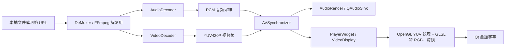
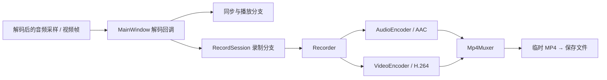
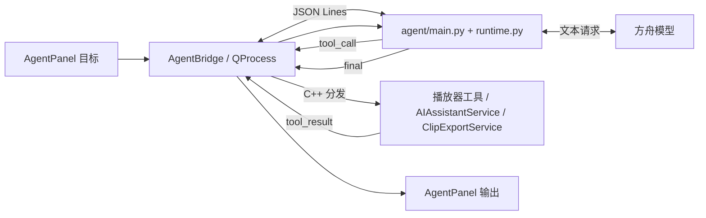

# 📋 项目简介

AVPlayer 是一款基于 **C++17、Qt、FFmpeg 和 OpenGL** 的桌面音视频播放器。项目包含本地/网络媒体播放、音视频同步、录制、截图与视频滤镜；OpenCV 用于人脸关键点检测和动态贴纸定位。AI 助手提供字幕转写、视频摘要、字幕语义搜索和智能剪辑，Agent 工作台通过 Python 编排客户端工具。

Agent 编排采用 Python Runtime，播放器能力由 C++ 工具执行，双方通过 `avplayer.agent.v1` JSON Lines 协议通信。各模块职责与完整数据流见下文“项目结构与数据流”。


# ✨ 核心功能

## 基础播放

-   基于 FFmpeg 解复用与解码常见音视频格式；实际可播放格式取决于所链接的 FFmpeg 构建
-   支持本地文件以及由 FFmpeg 打开的 HTTP(S)、RTSP、RTMP 等网络媒体源
-   播放控制：播放 / 暂停、进度拖拽和跳转到开头

## 高级功能

-   🎥 **音视频录制**：对当前媒体的解码帧重新编码，封装为 MP4
-   🎨 **视频滤镜**：灰度、反相、垂直翻转及动态贴纸
-   🧠 **人脸关键点**：通过 OpenCV LBF 检测并辅助贴纸定位
-   📸 **画面截图**：保存播放器当前显示画面
-   🤖 **AI 与 Agent**：字幕转写、文本分析、语义搜索、智能剪辑及自然语言工具编排

# 🏗️ 技术栈

| 模块 | 技术 |
| --- | --- |
| 客户端 | C++17、Qt 6 Widgets / Multimedia |
| 解复用、解码、编码与封装 | FFmpeg |
| 视频渲染 | OpenGL、GLSL、`QOpenGLWidget` |
| 人脸关键点与贴纸定位 | OpenCV LBF |
| AI 助手与 Agent | 豆包语音 API、火山方舟文本模型、Python 3 Runtime |
| 构建与依赖 | CMake、Conan |

## 🚀 快速开始

### 环境依赖

-   当前开发构建环境：macOS、Qt 6（各模块版本一致）；其他平台需自行验证依赖和构建配置
-   构建工具：CMake 3.23+、Conan 2.x、C++17 编译器
-   核心依赖：FFmpeg、包含 `face` 模块的 OpenCV、Qt 6 Widgets / Multimedia / OpenGL
-   AI/Agent 运行依赖：Python 3，以及可在 `PATH` 中调用的 `ffmpeg` 命令；在线能力需要配置豆包 API 密钥


-   **克隆项目**  
    ```
    git clone https://github.com/Qiao12-pixel/avplayer.git
    cd avplayer
    ```
    
-   **安装依赖（Conan）**
    ```
    conan install . --build=missing -s compiler.cppstd=17
    ```
    
-   **CMake 构建**
    ```
    mkdir build && cd build
    cmake .. -DCMAKE_BUILD_TYPE=Release
    make -j8
    ```
-   **运行程序**
    ```
    ./AVPlayer
    ```
## 📁 项目结构与数据流

以下目录树按实际源码职责整理；`resource/` 和 `config/secret_key.yaml` 属于本地资源与配置，构建产物不在树中。

```text
AVPlayer/
├── AV/
│   ├── include/                 # 公共视频滤镜接口
│   └── src/
│       ├── Reader/              # FileReader、DeMuxer、音视频解码器
│       │   └── Interface/       # 读取、解复用、解码的 Listener 接口
│       ├── Engine/              # AVSynchronizer、AudioRender、GLContext
│       ├── Display/             # VideoDisplay：YUV 纹理和 GLSL 渲染
│       ├── VideoFilter/         # 灰度、反相、翻转、贴纸滤镜
│       ├── FaceDetect/          # OpenCV LBF 人脸关键点与贴纸位置
│       ├── Writer/              # RecordSession、Recorder、编码器、MP4 封装
│       ├── Network/             # 媒体源 URL 类型与连接状态
│       ├── AI/                  # 字幕、豆包语音/文本 API、摘要/搜索/剪辑
│       ├── Agent/               # Python 桥接、JSON 协议、工具分发、片段导出
│       ├── Core/                # 线程通知与任务池
│       └── Define/              # 音视频帧、压缩包等基础数据结构
├── qt/
│   ├── Main.cpp                 # Qt 应用入口
│   ├── MainWindow.{h,cpp}       # 播放器装配、事件与工具接线
│   └── ui/
│       ├── PlayerWidget.*       # QOpenGLWidget 画面与字幕叠加
│       ├── ControllerWidget.*   # 底部播放、录制、截图与滤镜控制
│       ├── ai/                  # AI 助手侧栏界面
│       └── agent/               # Agent 工作台侧栏界面
├── agent/
│   ├── main.py                  # Python Runtime 入口、stdin/stdout 循环
│   ├── runtime.py               # 目标到工具调用的编排循环
│   ├── protocol.py              # JSON Lines 消息格式
│   ├── ark_client.py            # 方舟文本模型请求
│   ├── tools/                   # 工具扩展说明，当前无独立 Python 工具实现
│   └── schemas/                 # 协议/参数扩展说明，当前无独立 schema 文件
├── config/
│   ├── secret_key.example.yaml  # API 配置样例
│   └── secret_key.yaml          # 本地密钥，需自行创建且不应提交
├── resource/                    # 本地示例媒体和贴纸素材
├── CMakeLists.txt               # C++/Qt 目标及依赖配置
├── conanfile.txt                # Conan 依赖声明
└── README.md
```

### 播放与渲染数据流



`MainWindow` 创建 `FileReader`，由它串联解复用器与两个解码器；解码回调把音视频数据交给 `AVSynchronizer`。音频经 `QAudioSink` 输出，音频时钟可用时作为主时钟；无有效音频时回退到视频时钟。视频调度使用 `视频帧 PTS - 主时钟`，超前不超过 10 ms 时显示，使用音频时钟且落后超过 80 ms 时丢帧。视频解码器把非 YUV420P 帧转换为 YUV420P；`VideoDisplay` 将 Y、U、V 平面上传 GPU，由片段着色器完成 YUV→RGB、灰度/反相及贴纸合成。字幕依据当前呈现帧的时间戳在 `PlayerWidget` 中叠加，因此不进入编码帧本身。

拖动进度条时，`MainWindow` 将目标位置交给 `FileReader/DeMuxer`；解复用器发出 `KFlush` 标记包，音视频解码器清理旧包并刷新解码状态，视频同步队列收到刷新帧后清空旧画面及视频时钟，再从新位置的时间戳继续调度。

| 跨层数据 | 产生位置 | 消费位置 | 关键字段或用途 |
| --- | --- | --- | --- |
| `IAVPacket` | `DeMuxer` | `AudioDecoder` / `VideoDecoder` | FFmpeg 压缩包、时间基与 `KFlush` 标记 |
| `IAudioSamples` | `AudioDecoder` | `AVSynchronizer` / `Recorder` | 重采样后的 PCM、PTS、采样率与声道数 |
| `IVideoFrame` | `VideoDecoder` | `AVSynchronizer` / `Recorder` | 紧凑排列的 YUV420P、PTS、色彩范围与矩阵信息 |
| `TranscriptSegment` | 豆包语音识别或旁路 `.srt` | 字幕显示、摘要/搜索/剪辑 | 毫秒起止时间与字幕文本 |
| Agent JSON 消息 | Qt 或 Python Runtime | 对端进程 | 协议版本、消息类型、`request_id`、工具参数或结果 |

解复用器和音视频解码器各有工作线程及异步队列，`Listener` 回调把数据推向下一层。音视频数据以 `shared_ptr` 传递；包/帧销毁时通过释放回调归还流水线额度，限制上游继续生产。同步器的视频队列上限为 60 帧，超限时丢弃最早帧。音频样本进入 Qt 音频设备前经主线程排队调用，避免从解码线程直接操作 `QAudioSink`。

### 录制数据流



录制接收的是解码后的音视频帧，与播放分支并行；`RecordSession` 管理开始、停止、临时文件和最终保存。这里不是对播放器窗口进行屏幕录制，界面字幕和仅在显示阶段合成的滤镜/贴纸不会自动写入录制输出。

### AI 助手与 Agent 数据流



独立的 **AI 助手侧栏**直接调用 `AIAssistantService`：FFmpeg 提取音轨 → 豆包语音识别 → 视频旁生成 `.ai.srt` → 播放器按时间轴显示字幕；摘要、语义搜索和智能剪辑再使用字幕文本与时间戳调用方舟文本模型。**Agent 侧栏**则先将自然语言目标交给 Python Runtime，模型在 C++ 提供的工具目录中选择操作；Qt 执行后回传结果，模型继续调用工具或返回最终答案。随机片段导出由 `ClipExportService` 直接对当前本地视频调用 FFmpeg，不依赖字幕。

| Agent 工具 | 执行方式 | 前置条件 / 结果 |
| --- | --- | --- |
| `get_media_context`、`player_control` | C++ 同步 | 读取媒体状态，或对已加载媒体执行播放控制 |
| `capture_screenshot` | C++ 同步 | 需要已呈现画面；输出 PNG |
| `transcribe_subtitle` | `AIAssistantService` 异步 | 本地媒体、语音 API；生成 `.ai.srt` |
| `summarize_video`、`semantic_search` | `AIAssistantService` 异步 | 已加载字幕；搜索还需要查询文本 |
| `smart_edit`、`export_clip` | `AIAssistantService` 异步 | 带时间戳的字幕与本地媒体；先生成建议，再指定目录导出 MP4 |
| `export_random_clip` | `ClipExportService` 异步 | 本地媒体与 `duration_ms`；直接输出随机起点的 MP4 |

两进程通过 `avplayer.agent.v1` 协议传输 `goal`、`tool_catalog`、`tool_call`、`tool_result`、`status`、`final` 等消息，`request_id` 关联调用和结果。当前模型通过提示词返回 JSON 指令，而非 API 原生 function calling；Agent 面板中的“执行计划”仍是预置展示，不代表实时生成的计划。摘要、语义搜索与智能剪辑只分析字幕，尚无视频帧视觉理解或向量索引；`agent/tools/` 与 `agent/schemas/` 目前是扩展预留目录。

## 🎯 功能演示

### 1. 基础播放

-   支持本地视频 / 网络视频地址加载，实现音视频同步播放
-   精准控制播放进度，支持 seek 精准定位
-   点击底部“截图”可保存点击时播放器显示的画面为 PNG，包含当前滤镜、贴纸和已显示的字幕；无视频时按钮不可用。

### 2. 录制与滤镜

-   录制当前媒体的解码音视频帧，输出 MP4 格式文件
-   实时切换灰度、反相、垂直翻转及动态贴纸

### 3. AI 助手与 Agent

-   对本地视频生成时间轴字幕，并在播放画面中同步显示
-   使用字幕生成摘要、搜索相关片段或生成剪辑建议；Agent 可将自然语言目标转换为工具调用

## 📝 开发计划

-   新增更多滤镜特效（马赛克、复古、动态模糊）
-   提高 RTSP/RTMP 等网络媒体源的稳定性与断线恢复能力
-   优化硬件解码性能，适配更多编解码器
-   移动端（Android/iOS）跨平台适配

## 🤝 贡献

欢迎提交 Issue 或 PR！提交 PR 前请确保：

1.  代码符合 C++ 编码规范，注释清晰
2.  新增功能附带测试用例
3.  不破坏现有功能兼容性

## 📄 许可证

本项目基于 **MIT License** 开源，详见 [LICENSE](LICENSE) 文件。

## 📞 联系方式

-   作者：Qiao12-pixel
-   GitHub：[https://github.com/Qiao12-pixel](https://github.com/Qiao12-pixel)

----------


## AI 助手（本地客户端 + 豆包 API）

侧栏支持字幕转写、视频摘要、语义搜索和智能剪辑。视频文件保留在本地；转写会用本机 `ffmpeg` 抽取单声道 MP3，再将音频发送至豆包语音 API。摘要、搜索和剪辑会将字幕文本发送至火山方舟 Chat API。请确认媒体内容允许上传至这些服务。

在项目的 `config/secret_key.yaml` 中填写 API 配置。可复制 `config/secret_key.example.yaml` 的字段结构：

```yaml
doubao_api_key: "你的火山方舟 API Key"
doubao_model: "doubao-seed-2-0-lite-260428"
doubao_speech_api_key: "你的豆包语音新版控制台 API Key"
# doubao_chat_endpoint: "https://ark.cn-beijing.volces.com/api/v3/chat/completions"
```

语音密钥需开通 `volc.bigasr.auc_turbo`。配置在启动时读取；修改后请重启播放器。客户端会优先查找可执行文件目录和工作目录下的 `config/secret_key.yaml`，开发构建还会查找项目根目录。缺失字段或格式错误会在 AI 侧栏显示，不显示密钥值。该文件被 `.gitignore` 忽略，请勿提交真实密钥。配置文件仅支持示例所示的顶层字符串键值对。

`doubao_api_key` 是火山方舟的模型调用密钥；`doubao_speech_api_key` 必须从[豆包语音控制台的 API Key 管理](https://console.volcengine.com/speech/new/setting/apikeys?projectName=default)获取，二者不能直接共用。请在同一语音项目下开通录音文件识别极速版。转写返回 `HTTP 401 / 45000010 Invalid X-Api-Key` 时，先核对语音密钥所属产品和项目。

视频摘要、语义搜索与智能剪辑都通过方舟 Chat API 调用文本模型。已验证 `doubao-seed-2-0-lite-260428` 可用于本项目；Seedream 属于图片生成模型，不能用于这些按钮。播放器会自动加载视频旁的 `.ai.srt` 或 `.srt` 时间轴字幕并叠加显示；AI 侧栏可切换字幕显示。

本地媒体需能由 `ffmpeg` 读取，并且 `ffmpeg` 在 `PATH` 中。点击“字幕转写”后，软件会在视频旁保存同名 `.ai.srt` 文件。已有同名 `.ai.srt`、`.srt` 或 `.txt` 文件会自动加载；智能剪辑需要含时间戳的 `.srt`。生成剪辑建议后，点击“导出建议片段”并选择目录，各时间段会重新编码为独立的 MP4 文件。当前转写音频上限 20 MB，字幕分析上限 2 万字；网络流不支持直接转写和导出。API 密钥只从本地配置文件读取，不写入日志或其他项目文件。
