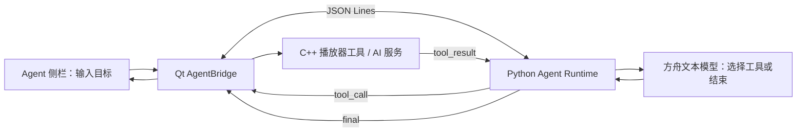

# 📋 项目简介

AVPlayer 是一款轻量级跨平台音视频播放器，核心基于 **C++ + Qt** 框架开发，依托 FFmpeg 实现音视频编解码与播放，结合 OpenCV 完成 AI 人脸关键点检测与滤镜特效。项目支持主流音视频格式播放、音视频录制、自定义滤镜特效，同时提供简洁的 Qt 交互界面，适配 macOS 等平台，可作为音视频开发学习、技术面试项目展示的优质案例。
### 增加了avplayer的ai能力，包括：字幕转写，视频摘要生成，语义搜索，智能剪辑

Agent 工作台使用 Python 编排、C++ 执行媒体工具；完整流程、工具清单及当前能力边界见下文“Agent 工作台”章节。


# ✨ 核心功能

## 基础播放

-   支持 **MP4、AVI、MKV、FLV** 等主流音视频格式解码播放
-   跨平台兼容（基于 Qt，支持 macOS/Windows）
-   播放控制：播放 / 暂停、进度拖拽、音量调节、倍速播放

## 高级功能

-   🎥 **音视频录制**：支持将播放流 / 本地摄像头画面录制为 MP4 格式
-   🎨 **自定义滤镜**：集成基础滤镜特效（如灰度、美颜、边缘检测）
-   🧠 **AI 人脸检测**：基于 OpenCV 实现人脸关键点检测，叠加显示检测框 / 关键点
-   🔧 **上传视频修复**：兼容异常格式视频解析，优化上传视频播放兼容性
# 🏗️ 技术栈
|  技术模块| 工具 |
|--|--|
|开发语言  | c++17
UI框架 |qt6
|  音视频引擎| ffmpeg |
|AI视觉|Opencv|
|  构建工具| CMake Conan
|平台适配|  macOS|
## 🚀 快速开始

### 环境依赖

-   操作系统：macOS 10.15+ / Windows 10+
-   开发工具：Qt Creator / CLion、CMake 3.20+、Conan 2.0+
-   依赖库：FFmpeg 4.4+、OpenCV 4.5+、Qt Multimedia


-   **克隆项目**  
    ```
    git clone https://github.com/Qiao12-pixel/avplayer.git
    cd avplayer
    ```
    
-   **安装依赖（Conan）**
    ```
    conan install . --build=missing -s compiler.cppstd=17
    ```
    
-   **CMake 构建**
    ```
    mkdir build && cd build
    cmake .. -DCMAKE_BUILD_TYPE=Release
    make -j8
    ```
-   **运行程序**
    ```
    ./AVPlayer
    ```
📁 项目结构
```
AVPlayer/ ├── AV/ # 音视频核心模块（编解码、播放、录制） 
					├── qt/ # Qt 界面交互模块 
					├── resource/ # 资源文件（UI布局、图标、配置） 
					├── CMakeLists.txt # CMake 构建配置 
					├── conanfile.txt # Conan 依赖配置 
					├── README.md # 项目说明 
					└── .gitignore # Git 忽略配置
```
## 🎯 功能演示

### 1. 基础播放

-   支持本地视频 / 网络视频地址加载，实现音视频同步播放
-   精准控制播放进度，支持 seek 精准定位
-   点击底部“截图”可保存点击时播放器显示的画面为 PNG，包含当前滤镜、贴纸和已显示的字幕；无视频时按钮不可用。

### 2. 录制与滤镜

-   一键录制当前播放画面，输出 MP4 格式文件
-   实时切换滤镜特效，叠加人脸检测框，直观展示 AI 检测效果

### 3. 异常处理

-   自动修复上传视频的编码异常，提升视频播放兼容性

## 📝 开发计划

-   新增更多滤镜特效（马赛克、复古、动态模糊）
-   支持流媒体协议（RTSP/RTMP）播放
-   优化硬件解码性能，适配更多编解码器
-   移动端（Android/iOS）跨平台适配

## 🤝 贡献

欢迎提交 Issue 或 PR！提交 PR 前请确保：

1.  代码符合 C++ 编码规范，注释清晰
2.  新增功能附带测试用例
3.  不破坏现有功能兼容性

## 📄 许可证

本项目基于 **MIT License** 开源，详见 [LICENSE](LICENSE) 文件。

## 📞 联系方式

-   作者：Qiao12-pixel
-   GitHub：[https://github.com/Qiao12-pixel](https://github.com/Qiao12-pixel)

----------


## AI 助手（本地客户端 + 豆包 API）

侧栏支持字幕转写、视频摘要、语义搜索和智能剪辑。视频文件保留在本地；转写会用本机 `ffmpeg` 抽取单声道 MP3，再将音频发送至豆包语音 API。摘要、搜索和剪辑会将字幕文本发送至火山方舟 Chat API。请确认媒体内容允许上传至这些服务。

在项目的 `config/secret_key.yaml` 中填写 API 配置。可复制 `config/secret_key.example.yaml` 的字段结构：

```yaml
doubao_api_key: "你的火山方舟 API Key"
doubao_model: "doubao-seed-2-0-lite-260428"
doubao_speech_api_key: "你的豆包语音新版控制台 API Key"
# doubao_chat_endpoint: "https://ark.cn-beijing.volces.com/api/v3/chat/completions"
```

语音密钥需开通 `volc.bigasr.auc_turbo`。配置在启动时读取；修改后请重启播放器。客户端会优先查找可执行文件目录和工作目录下的 `config/secret_key.yaml`，开发构建还会查找项目根目录。缺失字段或格式错误会在 AI 侧栏显示，不显示密钥值。该文件被 `.gitignore` 忽略，请勿提交真实密钥。配置文件仅支持示例所示的顶层字符串键值对。

`doubao_api_key` 是火山方舟的模型调用密钥；`doubao_speech_api_key` 必须从[豆包语音控制台的 API Key 管理](https://console.volcengine.com/speech/new/setting/apikeys?projectName=default)获取，二者不能直接共用。请在同一语音项目下开通录音文件识别极速版。转写返回 `HTTP 401 / 45000010 Invalid X-Api-Key` 时，先核对语音密钥所属产品和项目。

视频摘要、语义搜索与智能剪辑都通过方舟 Chat API 调用文本模型。已验证 `doubao-seed-2-0-lite-260428` 可用于本项目；Seedream 属于图片生成模型，不能用于这些按钮。播放器会自动加载视频旁的 `.ai.srt` 或 `.srt` 时间轴字幕并叠加显示；AI 侧栏可切换字幕显示。

本地媒体需能由 `ffmpeg` 读取，并且 `ffmpeg` 在 `PATH` 中。点击“字幕转写”后，软件会在视频旁保存同名 `.ai.srt` 文件。已有同名 `.ai.srt`、`.srt` 或 `.txt` 文件会自动加载；智能剪辑需要含时间戳的 `.srt`。生成剪辑建议后，点击“导出建议片段”并选择目录，各时间段会重新编码为独立的 MP4 文件。当前转写音频上限 20 MB，字幕分析上限 2 万字；网络流不支持直接转写和导出。API 密钥只从本地配置文件读取，不写入日志或其他项目文件。

## Agent 工作台（Python 编排 + C++ 执行）

Agent 完全运行在本地客户端：Qt/C++ 持有播放器状态、画面和文件系统操作；Python 子进程调用方舟文本模型，决定下一步使用哪个已注册工具。这里不需要单独部署播放器服务端。



### 一次任务如何执行

1. 用户输入目标并点击“开始执行”，或点击“整理视频内容”等快捷目标。`AgentPanel` 发出 `goalSubmitted`，`MainWindow` 启动 `agent/main.py` 并发送目标。
2. Python 启动后接收 C++ 注册的 `tool_catalog`。双方使用 `avplayer.agent.v1` 协议，以一行一个 JSON 对象交换 `goal`、`tool_call`、`tool_result`、`status`、`final` 和 `error` 消息；`request_id` 用于关联调用与结果。
3. `agent/runtime.py` 把用户目标与工具定义发给方舟模型。模型返回严格 JSON，例如 `{"kind":"tool_call","tool":"export_random_clip","arguments":{"duration_ms":3000}}`。当前使用提示词约束文本 JSON，尚未使用模型 API 原生的 function calling。
4. `MainWindow` 根据工具名派发：播放控制、媒体上下文和截图可同步返回；转写、文本分析及片段导出完成后，通过 Qt 信号异步回传结果。Python 把工具结果加入本次对话，再决定调用下一工具或给出最终答复。Agent 输出区展示结果及生成文件路径。

### 工具与实现位置

| 工具 | 执行位置 | 作用 |
| --- | --- | --- |
| `get_media_context`、`player_control`、`capture_screenshot` | `qt/MainWindow.cpp`、`AV/src/Agent/ToolDispatcher.cpp` | 读取当前媒体状态、控制播放、保存当前画面 |
| `transcribe_subtitle` | `AV/src/AI/DoubaoSpeechClient.cpp`、`TranscriptStore.cpp` | FFmpeg 提取音轨、调用豆包语音识别、生成带时间戳的 `.ai.srt` |
| `summarize_video`、`semantic_search` | `AV/src/AI/AIAssistantService.cpp` | 根据字幕文本生成摘要或查找相关句子及时间戳 |
| `smart_edit`、`export_clip` | `AV/src/AI/AIAssistantService.cpp` | 根据字幕时间轴生成剪辑建议，再导出建议片段 |
| `export_random_clip` | `AV/src/Agent/ClipExportService.cpp` | 不依赖字幕，在本地视频中随机选起点并异步导出指定时长的 MP4；未指定目录时保存到系统“影片/AVPlayer”目录 |

界面定义在 `qt/ui/agent/AgentPanel.{h,cpp}`；进程通信与协议分别在 `AV/src/Agent/AgentBridge.{h,cpp}`、`AgentProtocol.{h,cpp}` 和 `agent/protocol.py`；方舟请求由 `agent/ark_client.py` 发起。`config/secret_key.yaml` 提供 API 密钥，但不应提交到仓库。

**当前边界：**执行计划列表目前是界面预置步骤，不是实时生成的计划；摘要、语义搜索和智能剪辑只分析字幕，没有将视频帧交给视觉模型；语义搜索没有向量索引；尚无独立的 Skill 加载/管理或多智能体框架。Agent Runtime 在新目标到来时重置本次对话，当前不提供跨任务持久记忆。
